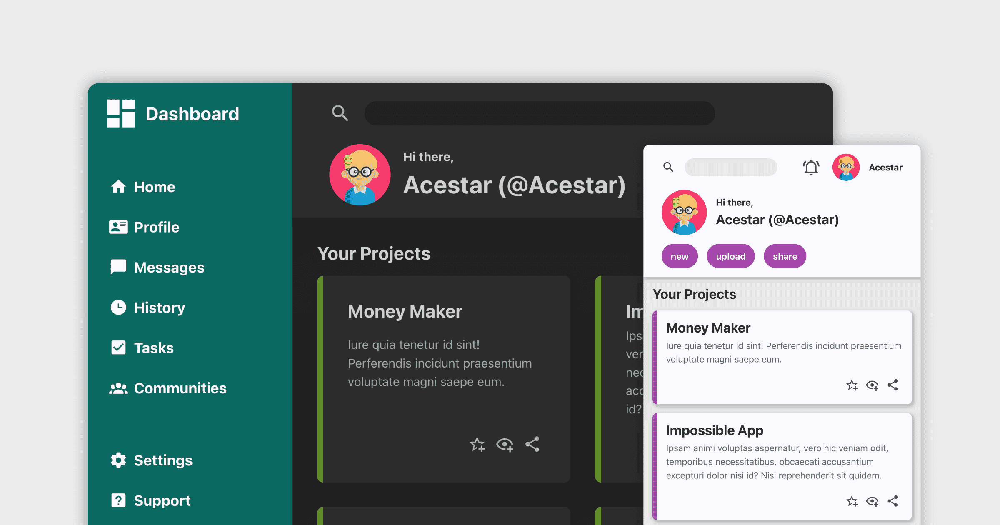
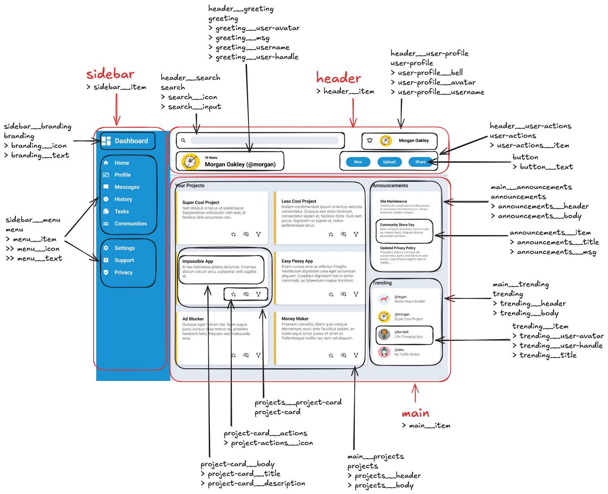

<div align="center">



# The Odin Project - Admin Dashboard


A solution to the [Project: Admin Dashboard](https://www.theodinproject.com/lessons/node-path-intermediate-html-and-css-admin-dashboard)'s challenge from The Odin Project.

[Source Code](https://github.com/sydalwedaie/odin-project-admin-dashboard) •
[Live Preview](https://odin-project-admin-dashboard-x9zka.netlify.app/#)
</div>

## Project Description

The goal is to replicate the provided mockup in vanilla HTML/CSS, with a particular focus on the use of CSS Grid. As a self-imposed challenge, I used the [BEM Methodology](https://bem.info/en/methodology/) to name the classes and structure the files in a reusable component-based architecture. I also implemented a simple theme control with dark/light options and different colors.

## Learning Outcomes

Over the years, I have naturally developed my own style for organizing my JavaScript logic. I could not say the same for CSS. Using the [BEM Methodology](https://bem.info/en/methodology/) was a breath of fresh air. BEM is often referred to as a _CSS class naming convention_. In reality, it's a holistic methodology for organizing a project. Here are my takeaways on BEM, beyond the simple naming convention it is usually associated with.

## BEM class naming convention

I spent a while planning the naming conventions. I used Excalidraw to identify the components and apply names to each one. This was a conventions operation, as I edited the structure many times during the developement.



### Project Organization

Prior to this project, I would group my files based on _technology_: scripts, styles, assets. BEM recommends doing so based on _meaning_, which, for this project, mostly refers to the actual components. I ended up with something like this:

```
/components
    header/
        header.js
        header.css
        icons/
    sidebar/
        sidebar.js
        sidebar.css
        logo.svg
```

This was a total game changer! I have been separating my JS files into modules for ages. Why not do the same for CSS?! The proximity of all the _implementation_ details of a single component to each other meant I no longer needed to hunt down CSS rules in a jungle of entangled rules in one giant file. If I needed to modify the styles for the header, I would know I could find them in `header.css`, and `header.js` would be its companion.

### Separation of internal and external styles

The other pillar of the BEM methodology is the idea of **separating a component’s internal and external styles**. In a nutshell, a component should not have positioning and size rule sets defined on it. They should be defined on the parent block, or using a _parent selector_ on the same block. Therefore, if I had a header block with a nested `actions` block, I would create an additional `.header__actions` class to hold the positioning rules:

```html
<div class="header">
  <div class="actions header__actions"></div>
</div>
```

```css
.header__actions {
  margin-left: auto;
}

.actions {
  background-color: pink;
  padding: 1rem;
}
```

And here’s the banger that made this click for me: **A block can simultaneously be an element of another block**! In the example above, the `actions` block is also a `header__actions` element nested under the parent `header` block.

### Mixing blocks

The `actions` block would have 3 buttons. I would name each button as `.actions__btn` to act as _elements_ of the `actions` block. I would then define a dedicated block, called `button` with styles applicable to every button (not only the ones under `actions`. Then, I would mix it with `.actions__btn`:

```html
<button class="actions__btn button">New</button>
```

The `.actions__btn` selector is used for positioning (something that only makes sense within the `actions` block) and the `.button` selector for general look and feel of the button.

Furthermore, **blocks do NOT necessarily correspond in a one-to-one basis to DOM elements**. For example, we could have a dedicated `text` block that defines the general characteristics of text (font family, size, etc.), and mix it with the `header` block to make all the text in the header take on the same text style. Notice how, unlike the `header` block, we never had an HTML entity dedicated to `text`. It’s just a simple set of CSS rules, and we still call it a block.

### CSS Grids

After the many projects done with flexbox as my only weapon, learning CSS Grids made me realize what a fantastic addition it was to the language. In a nutshell, it made placing components on the 2D plane as trivial as literally placing blocks of LEGO!

My favorite way of using grid is `grid-template-areas` which basically lets me place blocks kind of like making ASCII art:

- Define the grid-template as usual.
- Name each _cell_ using grid-area in the _item selector_.
- Use grid-template-areas in the _container_ to position the cells by their names.
- _Repeating the name_ of a grid area causes the content to _span_ those cells.
- Use a dot . for _empty_ cells.

```css
.container {
  grid-template: <rows> <cols>;
  grid-template-areas:
    "cell-1 cell-1 cell-1"
    "cell-2 cell-2 cell-3"
    "cell-2 cell-2 cell-3";
}

#cell-1 {
  grid-area: cell-1;
}

#cell-2 {
  grid-area: cell-2;
}

#cell-3 {
  grid-area: cell-3;
}
```

Another creative use case is defining **invisible vertical grids** to make a responsive design without media queries. For this project, the right sidebar of the main content area takes roughly one-third of the main content’s width. However, as the viewport expands, that one-third becomes way too wide for a sidebar. Therefore, at wider widths, I needed the sidebar to be one-fourth of the container, and then one-fifth, and so forth.

I already knew about the use of `auto-fit` and `minmax` together to make items spread across a dynamic set of columns. I realized I could use the same technique to make the sidebar only take one fraction of a dynamically-adjusted set of columns:

```css
/* main.css */
.main {
  display: grid;
  grid-template-columns: repeat(auto-fit, minmax(130px, 1fr));
  /* ... */
}

.main__body {
  grid-column: 1 / -3;
}

.main__aside {
  grid-column: span 2 / -1;
}
```

Here, the parent `main` container is divided into columns of `130px` wide each. As the viewport expands, more columns are added, but the sidebar (named `.main__aside`) would always ocuppy the last 2 columns. Therefore, it would never get smaller than 130px, and never larger than 260px (plug gaps). Also note the use of negative grid line numbers, which is another key concept making this trick work. Since we never know the exact number of columns at any width, `-1` would always mean the last grid line.

## Little CSS tricks

- Use `filter: invert()` to modify the color of imported SVG icons in `img` tags.
- I needed `position: relative` on the parent header element to show its box shadow.
- `-webkit-tap-highlight-color: transparent;` removes the tap outline on touchscreen devices.

## Attribution

### Icons

- [Pictogrammers](https://pictogrammers.com)

### Avatars

- <a href="https://www.flaticon.com/free-icons/student" title="student icons">Student icons created by Magnific - Flaticon</a>
- <a href="https://www.flaticon.com/free-icons/animal" title="animal icons">Animal icons created by Magnific - Flaticon</a>
- <a href="https://www.flaticon.com/free-icons/duck" title="duck icons">Duck icons created by Magnific - Flaticon</a>
- <a href="https://www.flaticon.com/free-icons/muslim" title="muslim icons">Muslim icons created by Magnific - Flaticon</a>
